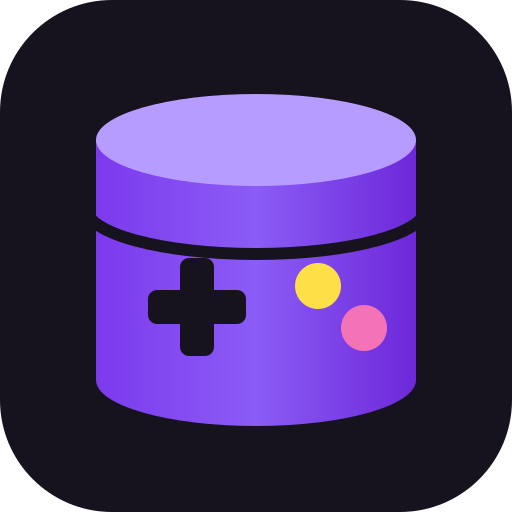
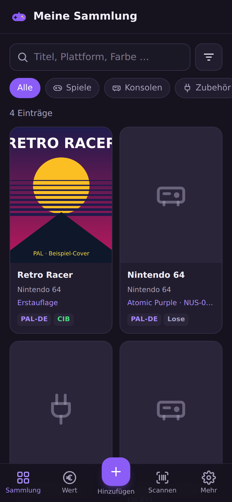
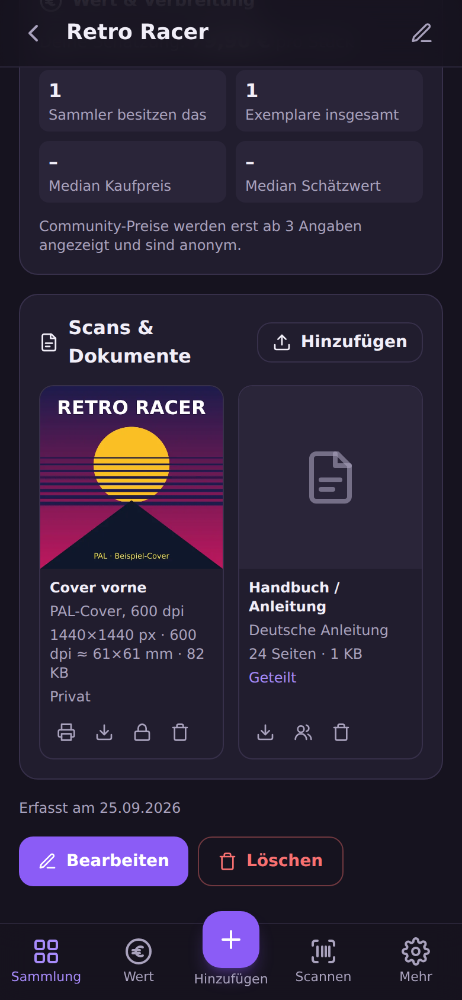
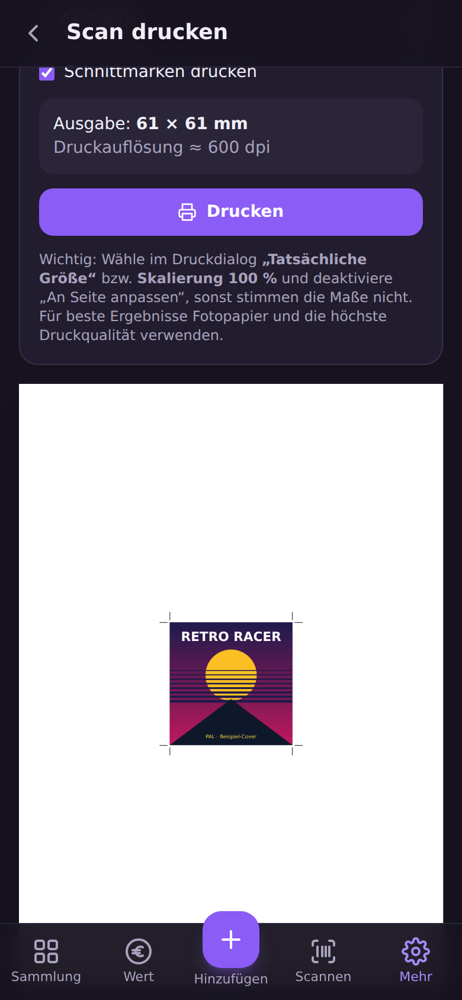

# 🎮 ZockerDB Basis

**Deine Spielesammlung selbst gehostet – mobil, auf Deutsch, auf deinem eigenen Server.**

<p></p>

ZockerDB Basis ist die frei verfügbare Grundversion von [zockerdb.de](https://zockerdb.de): eine Progressive Web App (PWA) zur
Verwaltung von **Spielen, Konsolen und Zubehör** – für dich allein oder zusammen mit Familie und Freunden. Gemacht für
Sammler im deutschsprachigen Raum: PAL-/USK-Regionen, CIB-Status, Sonderfarben, Editionen und Modellrevisionen lassen
sich sauber erfassen – per Titelsuche, **Barcode-Scan mit der Handykamera** oder als eigener Eintrag.

> 🌐 **Kein eigener Server? Nutze [zockerdb.de](https://zockerdb.de)** – sofort startklar, mit Erfolgen, Tauschbörse,
> Marktpreisen und Community. Wer dort mitmacht oder Zusatzleistungen bucht, **unterstützt die Weiterentwicklung von ZockerDB**. Danke! 💜

> 🇬🇧 An English version is available in [README.en.md](README.en.md).

> 🔒 **Sicherheitslücke gefunden?** Bitte vertraulich per E-Mail an [security@zockerdb.de](mailto:security@zockerdb.de) –
> Details in der [SECURITY.md](SECURITY.md).

<p align="center">
  
  &nbsp;
  
  &nbsp;
  
</p>

## Funktionen

- **Sammlung** mit Spielen, Konsolen und Zubehör – Zustand, Vollständigkeit (CIB, lose …), Region, Farbe, Edition,
  Modellnummer, Seriennummer, Kaufpreis, eigene Schätzung, Notizen und eigene Fotos
- **Barcode-Scanner im Browser** (EAN/UPC) über die Kamera – ganz ohne App-Store; einmal zugeordnete Barcodes werden gelernt
- **Zentraler Katalog über zockerdb.de:** Suche und Barcodes mit **echten deutschen Titeln** und deutschen Texten – ohne eigene
  IGDB-Zugangsdaten. Alternativ direkt über IGDB mit eigenem Twitch-Zugang
- **Sync mit zockerdb.de (optional):** eigene Sammlung in beide Richtungen abgleichen – unterwegs und mit Freunden ansehen,
  Erfolge sammeln; Scans bleiben zu Hause
- **Plattformen als feste Kategorien** (PS5, Switch, N64 …) nach Hersteller gruppiert, **Varianten/Revisionen** als Sammel-Checkliste,
  mehrere Exemplare je Spiel
- **Scans & Handbücher deiner eigenen Originale** privat archivieren (auch TIFF und PDF) – mit Druckansicht in
  Originalgröße für den privaten Gebrauch
- **Fotos: So sieht es aus** – Modul, Disc oder Diskette, Verpackung vorne und hinten, komplett mit Inhalt, Gerät und
  Details direkt mit der Handykamera; eine Checkliste zeigt, welche Fotos noch fehlen
- **Ohne Kaufpreis kein Problem:** Herkunft (Konvolut, Geschenk, „schon immer“ …), ungefähres Kaufdatum (nur Jahr) und
  **Konvolute** mit Gesamtpreis, der automatisch auf die Artikel verteilt wird
- **Private Kommentare**, **Statistik**, **Filter & Suche**
- **Mehrere Benutzer** mit eigenem, getrenntem Konto – Rollen *Nutzer*, *Moderator*, *Administrator*
- **Zwei-Faktor-Anmeldung** (TOTP) mit Wiederherstellungscodes, sichere Passwortspeicherung (scrypt)
- **Sammlung per Link teilen** – auch mit Menschen ohne Konto, Preise und Notizen bleiben privat
- **E-Mail** für „Passwort vergessen“, Bestätigung der Adresse und Benachrichtigungen (optional, per SMTP)
- **Export/Import:** JSON (vollständige Sicherung), CSV im deutschen Excel-Format, **Import aus CLZ Games/Excel**
- **Automatische Datensicherung** (7 Tage täglich, 12 Monate monatlich)
- **Einstellungen über die Weboberfläche** – ohne Neustart, API-Schlüssel verschlüsselt gespeichert
- **PWA:** installierbar auf Android, iOS und Desktop, zuletzt geladene Daten auch offline; hell & dunkel
- **Komplett auf Deutsch**

**Technik:** Node.js 22 · Express 5 · SQLite (better-sqlite3) · sharp · React 19 · Vite · Tailwind CSS 4

## Schnellstart mit Docker

Voraussetzung: [Docker](https://docs.docker.com/get-docker/) mit Docker Compose – oder Portainer, Dockge, Synology/QNAP.

1. [`docker-compose.yml`](docker-compose.yml) speichern bzw. in Portainer/Dockge als neuen **Stack** einfügen.
2. Die Einträge unter `environment:` anpassen (alle sind kommentiert; leere Werte `""` = Standard).
3. Starten:

```bash
docker compose up -d
```

Die App läuft unter **<http://localhost:3000>**. **Das erste Konto, das du registrierst, wird Administrator.**
Danach kannst du die Registrierung unter *Mehr → Administration → Einstellungen* schließen. Familie und Freunde lädst du dann
unter *Administration → Benutzer & Rollen → Jemanden einladen* per Link ein (7 Tage gültig, einmal nutzbar).

```bash
docker compose logs -f                        # Protokoll ansehen
docker compose pull && docker compose up -d   # Auf die neueste Version aktualisieren
```

Alle Daten (SQLite-Datenbank, Fotos, Scans und `geheimnis.key`) liegen im Docker-Volume `sammlung-daten` und bleiben
bei Updates erhalten. Setze `APP_SECRET` einmalig (`openssl rand -base64 32`) und ändere es danach **nie** wieder –
oder sichere `geheimnis.key` aus dem Volume; ohne diesen Schlüssel lassen sich 2FA-Geheimnisse nicht mehr entschlüsseln.

## Konfiguration

Mit Docker als Einträge unter `environment:`, ohne Docker in der Datei `.env` (Vorlage: [`.env.example`](.env.example)).
Viele Werte lassen sich zusätzlich unter *Administration → Einstellungen* ändern.

| Variable | Standard | Beschreibung |
| --- | --- | --- |
| `PORT` | `3000` | Port des Servers |
| `APP_SECRET` | automatisch | Schlüssel für 2FA-Geheimnisse und gespeicherte API-Schlüssel |
| `REGISTRATION_OPEN` | `true` | Dürfen sich neue Benutzer selbst registrieren? |
| `REQUIRE_2FA` | `false` | Zwei-Faktor-Anmeldung für alle Pflicht |
| `ZOCKERDB_CENTRAL` | `https://zockerdb.de` | Zentraler Katalog für Suche und Barcodes; `aus` = nur eigener IGDB-Zugang |
| `ZOCKERDB_DONATE` | `false` | Anonyme Datenspende an zockerdb.de (nur Anzahlen je Titel) |
| `TWITCH_CLIENT_ID` / `TWITCH_CLIENT_SECRET` | – | Eigener IGDB-Zugang – nur mit `ZOCKERDB_CENTRAL=aus` nötig (siehe unten) |
| `STEAM_API_KEY` | – | Optional: Import der Steam-Bibliothek als digitale Spiele (Schlüssel unter steamcommunity.com/dev/apikey) |
| `BARCODE_PROVIDERS` | `opengtindb,upcitemdb` | Barcode-Datenbanken in Abfragereihenfolge; leer = nur gelernte Barcodes |
| `OPENGTINDB_QUERYID` | – | Zugangsnummer für [opengtindb.org](https://opengtindb.org) |
| `STORAGE_QUOTA_MB` | `1024` | Speicher je Benutzer für Fotos und Scans (`0` = unbegrenzt) |
| `MAX_UPLOAD_MB` / `MEDIA_MAX_MB` | `8` / `200` | Maximale Größe von Fotos bzw. Scans/PDFs |
| `BACKUP_ENABLED` / `BACKUP_DAYS` / `BACKUP_MONTHS` | `true` / `7` / `12` | Automatische Datenbank-Sicherung |
| `SMTP_HOST` / `SMTP_PORT` / `SMTP_USER` / `SMTP_PASSWORD` / `SMTP_FROM` | – / `587` | E-Mail-Versand |
| `PUBLIC_URL` | – | Adresse, unter der die App erreichbar ist (nötig für Links in E-Mails) |
| `CAPTCHA_PROVIDER` | `altcha` | Spam-Schutz bei der Registrierung: `altcha`, `recaptcha` oder `aus` |
| `TRUST_PROXY` | – | Hinter einem Reverse-Proxy `1` setzen |
| `SESSION_DAYS` / `COOKIE_SECURE` | `30` / `auto` | Gültigkeit der Anmeldung, Cookie nur über HTTPS |

## Verbindung zu zockerdb.de

Standardmäßig sucht ZockerDB Basis über den **zentralen Katalog von zockerdb.de**. Das hat mehrere Vorteile:

- **Echte deutsche Titel und deutsche Beschreibungen** – ohne eigene IGDB-Zugangsdaten.
- **Einheitliche ZockerDB-IDs:** Jeder Titel existiert nur einmal. IGDB wird nur gefragt, wenn der Katalog noch nichts kennt –
  und der Treffer steht danach allen zur Verfügung.
- **„Zu ZockerDB freigeben“:** Eigene Einträge (z. B. seltene Hardware) kannst du auf der Katalogseite einreichen. Nach der
  Prüfung auf zockerdb.de wird dein Eintrag automatisch zum gemeinsamen Eintrag.
- **Sammlerzahlen:** Auf jeder Katalogseite siehst du, wie viele Sammler einen Titel bei ZockerDB besitzen.

Übertragen werden dabei nur Suchbegriffe und Barcodes – vom Server, nicht von deinem Browser, ohne Daten über dich.
Die Installation meldet sich beim ersten Kontakt automatisch an (ohne persönliche Daten). Mit `ZOCKERDB_CENTRAL: "aus"`
nutzt du stattdessen nur deinen eigenen IGDB-Zugang.

### Anonyme Datenspende (freiwillig)

Mit `ZOCKERDB_DONATE: "true"` (oder unter *Administration → Einstellungen*) meldet dein Server wöchentlich **nur Anzahlen**:
wie viele Sammler hier einen Titel besitzen, wie viele Exemplare es sind, und welche Barcodes zu welchem Titel gehören.
Keine Benutzernamen, Preise, Notizen oder Fotos. Unter *Administration → Übersicht* siehst du **genau**, was gesendet würde.
Jeder Benutzer kann sich im Konto ausnehmen. Dafür fließen deine Sammler in die Statistik von zockerdb.de ein – und du
bekommst Sammlerzahlen aller ZockerDB-Nutzer zurück.

### Sammlung mit zockerdb.de synchronisieren (freiwillig, je Benutzer)

1. Auf zockerdb.de: *Konto → Eigenen Server verbinden → Sync-Schlüssel erstellen*.
2. Hier: *Konto → zockerdb.de* → Schlüssel einfügen → **Verbinden**.

Danach wird die Sammlung alle 15 Minuten **in beide Richtungen** abgeglichen (bei Konflikten gewinnt die jüngere Änderung,
Löschungen werden übernommen). So hast du deine Sammlung unterwegs dabei, kannst sie mit Freunden teilen und sammelst
**Erfolge – die gibt es nur auf zockerdb.de**. **Scans und Handbücher bleiben immer zu Hause.** Eigene Fotos gehen nur mit,
wenn du es beim Artikel einschaltest („Foto auch auf zockerdb.de“) – verkleinert, und sie zählen dort zu deinem Speicherplatz.
Fotos, die du unterwegs auf zockerdb.de hinzufügst, werden zu Hause gespeichert.

## IGDB-Zugang einrichten

> Nur nötig, wenn du ohne zockerdb.de arbeitest (`ZOCKERDB_CENTRAL: "aus"`).

[IGDB](https://www.igdb.com) ist eine kostenlose Spieldatenbank von Twitch.

1. Unter <https://dev.twitch.tv/console> anmelden (Zwei-Faktor-Anmeldung muss aktiv sein).
2. *Anwendungen → Deine Anwendung registrieren*: Name frei wählbar, OAuth-Redirect `http://localhost`,
   Kategorie *Application Integration*, Client-Typ *Vertraulich*.
3. **Client-ID** kopieren, **neues Geheimnis** erzeugen und beide Werte eintragen.

Ohne IGDB funktioniert die App vollständig – du legst Artikel dann als eigene Einträge an.

## Barcode-Scanner, HTTPS und Reverse-Proxy

Browser geben die Kamera nur über **HTTPS** (oder `localhost`) frei. Empfohlen ist ein Reverse-Proxy mit automatischen
Zertifikaten, z. B. [Caddy](https://caddyserver.com):

```caddyfile
sammlung.example.de {
    reverse_proxy zockerdb:3000
}
```

Dazu `TRUST_PROXY: "1"` setzen und den Port nur lokal freigeben (`"127.0.0.1:3000:3000"`). Für den Zugriff nur im
Heimnetz eignen sich auch [Tailscale](https://tailscale.com) oder der Proxy deines NAS.

## Datensicherung

- **Je Benutzer:** *Mehr → Datensicherung → JSON-Export* (jederzeit wieder importierbar).
- **Automatisch:** täglich eine Sicherung der Datenbank im Datenordner (`sicherungen/`), einsehbar unter
  *Administration → Sicherungen*. Zum Wiederherstellen den Container stoppen, die Datei als `sammlung.db` in den
  Datenordner kopieren (`sammlung.db-wal` und `-shm` vorher löschen) und neu starten.
- **Komplett:** Sichere das gesamte Datenverzeichnis `/app/data` (inklusive `geheimnis.key`) – z. B. per
  Proxmox-/NAS-Backup – und bewahre eine Kopie außer Haus auf.

## Update per Knopf

Statt `docker compose pull && docker compose up -d` geht das Update auch mit dem Knopf **„Jetzt aktualisieren“** unter
*Administration → Übersicht → Update*. Die App selbst bekommt dafür keinen Zugriff auf Docker, das übernimmt ein kleiner
[Watchtower](https://github.com/nicholas-fedor/watchtower)-Container auf Anfrage:

1. In der `docker-compose.yml` den auskommentierten Dienst `watchtower` einschalten.
2. Einen Token erzeugen (`openssl rand -hex 32`) und bei `WATCHTOWER_HTTP_API_TOKEN` und `UPDATE_TOKEN` eintragen.
3. `UPDATE_URL: "http://watchtower:8080/v1/update"` setzen und `docker compose up -d` ausführen.

Beim Klick sichert ZockerDB zuerst die Datenbank. Dann lädt Watchtower das neue Image, falls es eins gibt, und startet
ZockerDB damit neu (etwa eine Minute nicht erreichbar). Die Seite lädt danach von selbst neu. Unter *Update* steht auch,
welcher Stand installiert ist, und ein Hinweis erscheint, sobald ein neuerer Stand verfügbar ist – mit der Liste der
**Neuerungen gegenüber deiner Version** (aus [NEUERUNGEN.md](NEUERUNGEN.md)). Die Versionshinweise deines installierten
Stands lassen sich dort ebenfalls aufklappen.

## Installation ohne Docker

Voraussetzung: **Node.js 22** oder neuer.

```bash
git clone https://github.com/DrdotHouse2106/ZockerDBBasis.git
cd ZockerDBBasis
npm ci
cp .env.example .env
npm run build     # Oberfläche bauen
npm start         # → http://localhost:3000
```

Entwicklung mit Hot-Reload: `npm run dev` (Oberfläche unter <http://localhost:5173>). Tests: `npm test`,
Browser-Tests: `npm run test:e2e`.

## Mitwirken

Beiträge sind willkommen – siehe [CONTRIBUTING.md](CONTRIBUTING.md). Dieses Repository wird automatisch aus der
Entwicklung von zockerdb.de aktualisiert; Pull Requests werden dort übernommen und erscheinen danach hier.

## Lizenz

**[PolyForm Noncommercial License 1.0.0](LICENSE)** ([deutsche Zusammenfassung](LIZENZ.md)): private, Hobby- und
gemeinnützige Nutzung ist erlaubt – inklusive Selbsthosting für dich, Familie, Freunde oder deinen Verein.
Kommerzielle Nutzung nur mit gesonderter Erlaubnis. Spieldaten und Coverbilder stammen von [IGDB.com](https://www.igdb.com).
